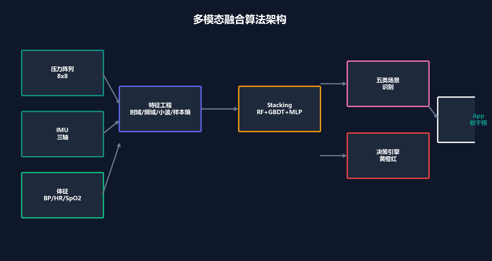
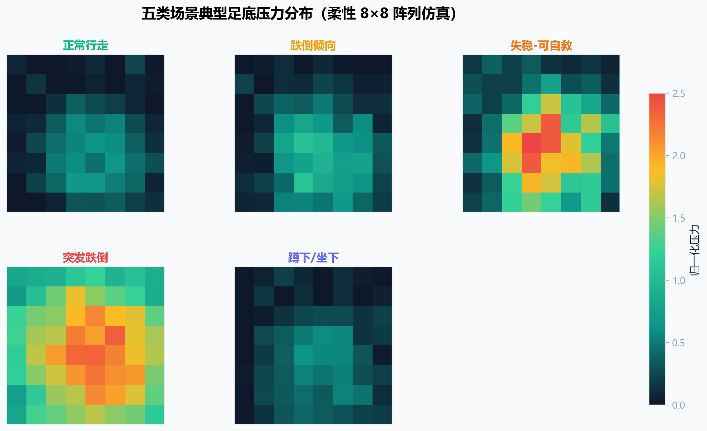
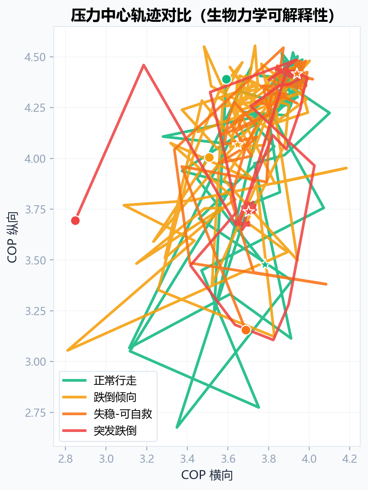
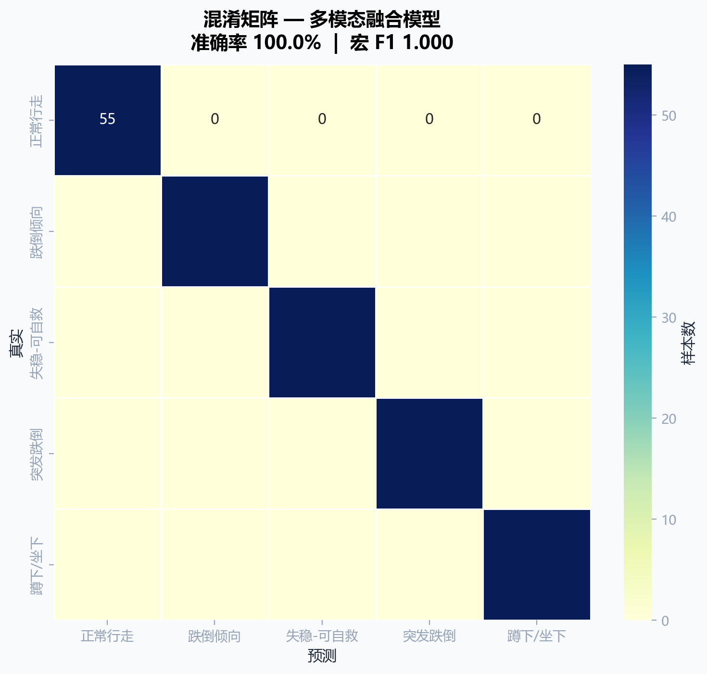

# MEMS足底压力步态监测与跌倒风险预警

这是一个面向老年人步态监测的可复现仿真项目。项目以8×8 MEMS足底压力阵列为核心，融合三轴IMU和体征特征，对正常行走、跌倒倾向、失稳可自救、突发跌倒、蹲下或坐下五类场景进行识别，并将识别结果映射为分级响应策略。

> 本项目使用参数化合成数据，目的在于验证信号处理、特征工程、分类和可视化链路。结果不代表真实受试者或临床场景中的性能，不能用于医疗诊断或紧急处置。



## 项目内容

- 8×8足底压力阵列与三轴IMU时序仿真
- 五类步态和跌倒相关场景生成
- 压力统计量、COP轨迹、时频、小波、非线性、IMU和体征特征
- Random Forest、GBDT、MLP组成的Stacking分类模型
- 混淆矩阵、ROC、PR曲线、学习曲线和特征重要性
- 模态遮蔽、噪声扰动和场景对比分析
- 五级风险决策与响应流程仿真
- 22张静态图和5个压力场GIF示例

## 核心流程

```text
参数化场景生成
    ↓
足底压力序列 + 三轴IMU + 体征仿真
    ↓
35维可解释特征
    ↓
Stacking分类模型
    ↓
五类场景识别
    ↓
分级风险决策与可视化
```

## 五类场景

| 类别 | 主要仿真特征 |
|---|---|
| 正常行走 | 左右足周期性交替，压力中心轨迹稳定 |
| 跌倒倾向 | 负荷不对称增加，步态稳定性下降 |
| 失稳可自救 | 短时压力和IMU紊乱，随后逐步恢复 |
| 突发跌倒 | 冲击峰值后进入低活动或静态状态 |
| 蹲下或坐下 | 姿态改变明显，但压力变化相对平稳 |

## 快速开始

### 1. 创建环境

建议使用Python 3.10或3.11。

```bash
python -m venv .venv
```

Windows：

```bash
.venv\Scripts\activate
```

macOS或Linux：

```bash
source .venv/bin/activate
```

### 2. 安装依赖

```bash
python -m pip install -r requirements.txt
```

### 3. 运行完整流程

```bash
python run_pipeline.py
```

运行后会在`results/`下生成模型摘要、图表和GIF。默认每类生成220条参数化合成样本，共1100条。

只进行训练和评估：

```bash
python run_pipeline.py --skip-figures
```

使用更小的数据量进行快速测试：

```bash
python run_pipeline.py --samples-per-class 30 --skip-figures --no-model-file
```

### 4. 运行测试

```bash
python -m pip install -r requirements-dev.txt
python -m unittest discover -s tests -v
```

## 示例结果

### 五类足底压力分布



### 压力中心轨迹



### 合成留出测试结果



默认参数下，五类合成场景在同一仿真机制生成的留出测试集中实现完全区分。该结果说明当前合成数据可分、代码链路可运行，不应解释为真实场景中的临床准确率。

## 目录结构

```text
.
├─ assets/                 # 已生成的图表和GIF示例
├─ docs/                   # 技术说明、结果与隐私说明
├─ src/                    # 仿真、特征、模型、决策与可视化代码
├─ tests/                  # 基础冒烟测试
├─ results/                # 运行时输出，默认不提交Git
├─ run_pipeline.py         # 一键运行入口
├─ requirements.txt
└─ README.md
```

## 主要模块

| 文件 | 作用 |
|---|---|
| `src/simulator.py` | 生成压力阵列和IMU时序，计算基础步态特征 |
| `src/features_advanced.py` | 提取小波、频域、样本熵和IMU特征 |
| `src/vitals.py` | 生成体征序列并执行阈值判断 |
| `src/models.py` | 构建数据集、训练Stacking模型并评估 |
| `src/decision_engine.py` | 将分类结果映射为分级响应动作 |
| `src/visuals.py` | 生成项目图表和五类压力场GIF |
| `src/video_demo.py` | 生成可选的流程演示视频 |

## 可复现性与限制

- 使用固定随机种子42。
- 默认数据为程序生成的参数化合成样本，没有采集或包含真实个人信息。
- 当前训练集和测试集来自同一生成机制，可能高估泛化性能。
- 模型文件采用pickle格式，仅应加载自己生成或可信来源的文件。
- 后续需要真实鞋垫标定、按受试者划分数据、跨场景外部测试和前瞻性评价。

更详细的算法说明见[技术说明](docs/TECHNICAL_NOTES.md)，图表和动态演示见[结果索引](docs/RESULTS.md)。

## 使用边界

本项目仅用于教学、研究和原型验证。风险决策代码是流程示例，不应直接连接真实报警、医疗或公共安全系统。
